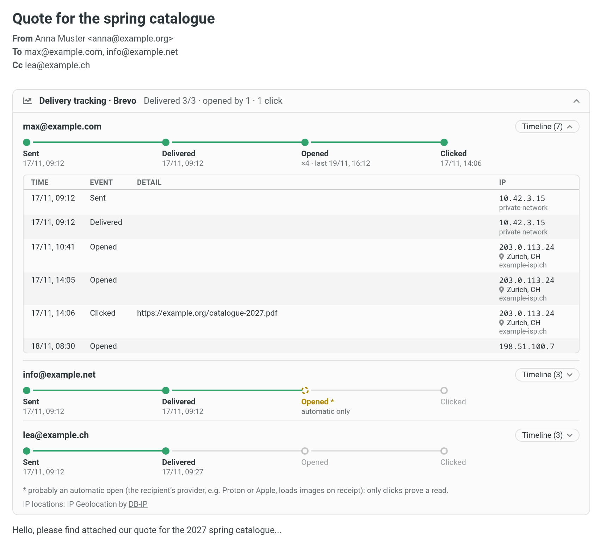

# relay_tracking: delivery tracking for Roundcube

Roundcube plugin for mail sent through a **transactional SMTP relay** (Brevo, Postmark, Mailgun, SendGrid, Mailjet,
Lettermint, SMTP2GO, Scaleway TEM, MailerSend, Amazon SES, Resend): every sent mail shows, per recipient, whether it
was delivered, opened, clicked, bounced, reported as spam or unsubscribed. Without a relay, or next to one, Roundcube
can also track opens and clicks itself ([self tracking](#self-tracking-optional)).




## Features

- **Delivery tracking box** above every sent mail: summary for all recipients, opened automatically on a problem.
- **Stepper per recipient**: Sent > Delivered > Opened > Clicked with dates and counts; bounces, blocked contacts,
  spam complaints and unsubscribes in red.
- **Timeline per recipient**: one row per event with time, event, detail (clicked link, bounce reason) and IP.
- **Retries and automatic opens kept apart**: a deferral followed by a delivery is a retry, not a problem; opens by
  image proxies (Apple, Proton, ...) are marked as automatic, since only clicks prove a read.
- **Self tracking** (optional, off by default): without a relay, or next to one, Roundcube itself adds an open pixel
  and sends the links through its own address, and shows the opens and clicks in the same box (Sent > Opened >
  Clicked). Chosen per mail with a "Track opens and clicks" box in compose; the sender's own views are not counted.
- **IP details** (optional): location (city, region, country), network owner or reverse DNS domain, and a link to an
  online lookup.
- **User preferences** (Settings > Preferences): show IP addresses, who they belong to, where they are (Displaying
  Messages > Delivery tracking); track opens and clicks of new mails by default (Composing Messages > Delivery
  tracking, with self tracking on).
- Dates in the user's Roundcube date format and timezone; English and French; light and dark mode.

**Roundcube holds no relay key.** A collector (a script on the server, with the key) reads the relay's API and writes
JSON files to a folder Roundcube only reads. One relay = one subfolder = one settings file for the collector, which
has a driver per relay (see [Relays](#relays)). Self tracking needs no key and no collector: Roundcube stores its own
opens and clicks in its database.

## Requirements

- Roundcube 1.6 or later with the Elastic skin (or a skin derived from it), PHP 7.3 or later.
- Self tracking: the plugin's two tables in Roundcube's database (MySQL/MariaDB, PostgreSQL or SQLite).
- Relays, on the server running the collector: bash 4+, curl (7.75+ for Amazon SES), jq 1.6+, flock, GNU date; `dig` for
  reverse DNS, `xz` for locations.
- Relays: a relay API key allowed to read its events (what each relay needs is in the header of its driver).

## Installation

### 1. Plugin

With Composer, from Roundcube's folder:

```sh
composer require p6g9yhk6/relay_tracking
```

Or by hand: copy this repository to `plugins/relay_tracking` and add it to the plugin list in `config/config.inc.php`:

```php
$config['plugins'][] = 'relay_tracking';
```

### 2. Folders

Keep everything under one folder, with the collector (key, config, state) out of Roundcube's reach:

```
/srv/relay-tracking/
  collector/   root only: script, config, state (caches, location data)
  data/        collector output, read by Roundcube
  plugin/      the plugin, if Roundcube runs in a container and loads it from a mount
```

```sh
install -d -m 755 /srv/relay-tracking /srv/relay-tracking/data
install -d -m 700 /srv/relay-tracking/collector
```

With Docker, mount `data/` (and `plugin/` if used) read-only:

```yaml
volumes:
  - /srv/relay-tracking/data:/var/roundcube/relays:ro
  - /srv/relay-tracking/plugin:/var/www/html/plugins/relay_tracking:ro
```

Then tell the plugin where the data is (default `/var/roundcube/relays`):

```php
$config['relay_tracking_dir'] = '/var/roundcube/relays';
```

### 3. Collector

On the server, as root (Brevo here; any relay of the [list](#relays)):

```sh
C=/srv/relay-tracking/collector
cp -r collectors/relay-collector.sh collectors/relays $C/
cp collectors/relay-collector.conf.example $C/brevo.conf
chmod 600 $C/brevo.conf

# the API key, alone in its file (paste it, then Ctrl-D)
umask 077; cat > $C/brevo.key
```

Edit `brevo.conf`:

```sh
RELAY=brevo
RELAY_DIR=/srv/relay-tracking/data/brevo
DOMAINS="example.org"
API_KEY_FILE=/srv/relay-tracking/collector/brevo.key
STATE_DIR=/srv/relay-tracking/collector/state/brevo
```

plus the optional settings below and those of the relay. Try it without writing anything, then schedule it every 5
minutes:

```sh
DRY_RUN=1 $C/relay-collector.sh $C/brevo.conf
echo "*/5 * * * * root $C/relay-collector.sh $C/brevo.conf" > /etc/cron.d/relay-tracking
```

The box appears for users with an identity on one of `DOMAINS`. Brevo publishes events up to 1-2 hours after
sending; until then a mail shows as pending. For a second relay, add another settings file, folder and cron line.

Upgrading from 2.3 and earlier: the old `brevo-collector.sh` keeps working. To move to the new one, copy the files
as above, add `RELAY=brevo` to the existing settings file and point the cron line at
`relay-collector.sh <settings file>`; nothing else changes.

### Self tracking (optional)

Needs no relay and no collector. Create the plugin's tables (Composer does it; by hand, from Roundcube's folder):

```sh
bin/initdb.sh --dir=plugins/relay_tracking/SQL --package=relay_tracking
```

then turn it on:

```php
$config['relay_tracking_self'] = true;
// when recipients reach Roundcube under another address than the one used to send
$config['relay_tracking_self_url'] = 'https://mail.example.org/';
```

The pixel and links point to `?_task=relay_tracking`, answered without a login: if a proxy or firewall puts Roundcube
behind an authentication, let that through. Each new mail gets a "Track opens and clicks" box in its options, ticked
per the user's preference (Settings > Preferences > Composing Messages). Only the HTML part is tracked: plain text
mail is sent as it is. All recipients get the same mail, so an open or a click can come from any of them; the box shows
one row for all of them, without delivery information. Opening the mail from the sender's own Roundcube session is not
counted.

An open within 20 seconds of sending, or from a client that gives no detail about itself (Apple Mail Privacy
Protection), is marked as automatic: the recipient's provider loading images on receipt, not a reader. A mail keeps at
most 500 opens and clicks. Upgrading from 2.4 and earlier: nothing to do unless you turn self tracking on, the tables
are only used then.

## Configuration

### Roundcube

Copy [`config.inc.php.dist`](config.inc.php.dist) to `config.inc.php` in the plugin folder, or set these in
Roundcube's main config.

| Option | Default | |
|---|---|---|
| `relay_tracking_dir` | `/var/roundcube/relays` | folder the collectors write to |
| `relay_tracking_untracked_after` | `86400` | seconds without any event before a mail shows "no tracking" instead of pending |
| `relay_tracking_show_ip` | `true` | default of the preference "Show IP addresses" |
| `relay_tracking_show_owner` | `true` | default of the preference "Show who the IP belongs to" |
| `relay_tracking_show_location` | `true` | default of the preference "Show where the IP is" |
| `relay_tracking_self` | `false` | self tracking: open pixel and links served by Roundcube |
| `relay_tracking_self_url` | `''` | public address of Roundcube in the pixel and links (empty: the one the mail was sent from) |
| `relay_tracking_self_track` | `true` | default of the preference "Track opens and clicks of the mails I send" |
| `relay_tracking_self_ip` | `false` | keep the IP of each open and click |
| `relay_tracking_self_days` | `90` | days the self tracking of a mail is kept (`0`: forever) |

The display preferences only change what is shown; add them to `$config['dont_override']` to enforce the defaults.
With `relay_tracking_self_track` in it, its value applies to every mail and the compose box is not shown.

### Collector

Set in the settings file (see [the example](collectors/relay-collector.conf.example)).

| Setting | Default | |
|---|---|---|
| `RELAY` | required | relay: `brevo`, `postmark`, `mailgun`, `sendgrid`, `mailjet`, `lettermint`, `smtp2go`, `scaleway`, `mailersend`, `ses`, `resend` |
| `RELAY_DIR` | required | output folder, e.g. `/srv/relay-tracking/data/brevo` |
| `DOMAINS` | required | sender domains going through the relay, space separated; other senders on the account are ignored |
| `API_KEY_FILE` | required | file holding only the API key (`chmod 600`) |
| `INCLUDE_IP` | `0` | `1` keeps the IP of each event |
| `IP_LOOKUP` | `0` | `1` adds each IP's reverse DNS name (needs `INCLUDE_IP=1`, `dig`) |
| `IP_ASN` | `0` | `1` adds the network owner, looked up at Team Cymru (sends the IPs to that third party) |
| `IP_GEO` | `0` | `1` adds the location from DB-IP Lite data, searched locally (needs `INCLUDE_IP=1`, `xz`) |
| `GEO_URL` | this repo's `geoip` branch | where the location data is downloaded from |
| `EVENT_DAYS` | what the relay keeps | days of events kept |
| `LAG` | the relay's | publication delay shown while a mail is pending |
| `STATE_DIR` | `/var/lib/relay-tracking-<relay>` | lock, caches, accumulated events, location data; keep it on persistent storage |

Relay settings (region, project, queue...) are listed at the end of the example and in each driver's header.

The config file is sourced as shell: it must belong to the user running the collector and not be writable by others,
or the collector refuses to start.

## Privacy

Open and click tracking is done by the relay (tracking pixel, rewritten links); turn it off at the relay if you do not
want it. The plugin only does it itself with self tracking (`relay_tracking_self`, off by default), on mail the sender
chose to track; it then keeps the date and type of each open and click, the clicked link, and the IP only with
`relay_tracking_self_ip`, for `relay_tracking_self_days`. For relays, without `INCLUDE_IP` the data holds only dates,
event types, clicked links and bounce reasons. IP addresses are the recipients' (or their provider's proxy): personal
data, so only keep them with a basis for it. Locations are looked up locally and never send the IPs anywhere; `IP_ASN`
sends them to Team Cymru, and the IP link sends one IP to iplocation.net when clicked. Self tracking looks nothing up:
its IPs (with `relay_tracking_self_ip`) are shown without location or owner.

## IP locations

The `geoip` branch holds [DB-IP](https://db-ip.com)'s free "IP to City Lite" database, converted by
[`tools/dbip-convert.py`](tools/dbip-convert.py) to two xz files (about 18 MB). A
[daily workflow](.github/workflows/geoip.yml) rebuilds the branch when DB-IP publishes a new month, as a single
commit. Collectors with `IP_GEO=1` check its `VERSION` once a day and download the files only when it changed.

IP Geolocation by DB-IP, licensed [CC BY 4.0](https://creativecommons.org/licenses/by/4.0/); the tracking box credits
it wherever a location is shown.

## Data format (v1)

What a collector writes to `<relay_tracking_dir>/<id>/` (`id`: `[a-z0-9_-]{1,32}`), atomically (temporary file, then
rename), folder `755` and files `644`:

| File | Content |
|---|---|
| `relay.json` | `{"format": 1, "id", "name", "domains": [..], "capabilities": [..], "lag", "events_days", "headers"?: {..}}` |
| `events.json` | `{"generated", "days", "since"?, "messages": {"<Message-ID>": {"<recipient>": [[date, type, extra?, ip?], ...]}}, "hosts"?: {"<ip>": {"rdns", "provider", "country"?, "region"?, "city"?}}}` |

- `capabilities`: `events` (required), `opens`, `clicks`.
- `headers`: headers the plugin adds to each mail sent from the relay's domains, `{message_id}` replaced by the mail's
  Message-ID; for relays that do not report the Message-ID (names `X-...` only, removed by the relay before delivery).
- `<Message-ID>`: the header as Roundcube sent it, angle brackets included. Recipient `"*"` = events without a
  recipient, applied to all of them.
- `since`: start of the data when the collector could not read the whole `days` window; older mails then show
  "history unavailable".
- Event types: `sent`, `delivered`, `deferred`, `soft_bounce`, `hard_bounce`, `blocked`, `invalid`, `error`, `opened`,
  `proxy_open`, `clicked`, `spam`, `unsubscribed`; others are ignored. `extra` = clicked link or bounce reason (`""`
  when empty but an IP follows). Dates in ISO 8601.

## Relays

| Relay | Events read from | Correlation with the Message-ID | Opens / clicks | IP | Default window |
|---|---|---|---|---|---|
| **Brevo** | global feed | kept by Brevo | yes | yes | 90 d |
| **Postmark** | search + details per message | `X-PM-Metadata-rt-mid` header | yes | first open, clicks | 45 d |
| **Mailgun** | Logs API, since the last run | `X-Mailgun-Variables` header | yes | yes | 30 d (plan) |
| **SendGrid** | Email Activity (paid add-on) | `X-SMTPAPI` unique argument | yes | no | 30 d |
| **Mailjet** | messages + history per message | `X-MJ-CustomID` header | yes, no link | no | 30 d |
| **Lettermint** | messages + events per message | `X-LM-Metadata-rt_mid` header | yes | no | 28 d |
| **SMTP2GO** | activity search, since the last run | Message-ID from the stored headers | yes | yes | 30 d (plan) |
| **Scaleway TEM** | state of each email | `message_id` (to check) | no | no | 30 d |
| **MailerSend** | activity, since the last run | `250 queued as` id from the Postfix log | yes | no | 30 d (plan) |
| **Amazon SES** | SNS > SQS queue, emptied each run | original headers in each event | yes | yes | 90 d (kept by the collector) |
| **Resend** | latest event per email only | `message_id` (to check) | latest only | no | 30 d |

The headers are added by the plugin when sending (from `headers` in `relay.json`), so only mail sent after the
collector first ran is tracked on those relays. Each driver in [`collectors/relays/`](collectors/relays) starts with
what it does, the key it needs, its settings and links to the relay's API documentation.

Brevo runs in production; the other drivers follow the relays' API documentation (November 2026) and are tested
against sample answers built from it, not yet against real accounts: try one with `DRY_RUN=1` and a real send first.
A new relay needs only a driver: the contract is at the top of
[`relay-collector.sh`](collectors/relay-collector.sh).

## License

GPL-3.0-or-later, like Roundcube (see [LICENSE](LICENSE)). Location data: DB-IP, CC BY 4.0.
