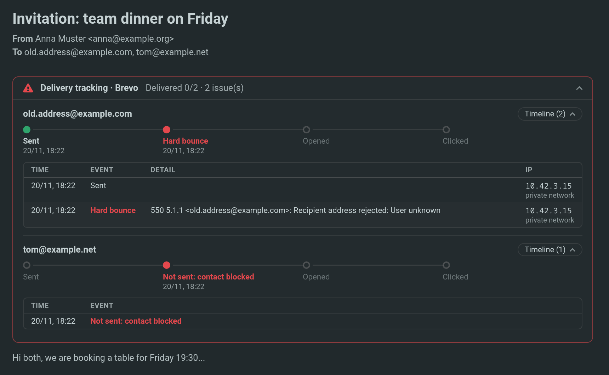

# relay_tracking: delivery tracking for Roundcube

Roundcube plugin for mail sent through a **transactional SMTP relay** (Brevo, ...): every sent mail shows, per
recipient, whether it was delivered, opened, clicked, bounced, reported as spam or unsubscribed.




## Features

- **Delivery tracking box** above every sent mail: summary for all recipients, opened automatically on a problem.
- **Stepper per recipient**: Sent > Delivered > Opened > Clicked with dates and counts; bounces, blocked contacts,
  spam complaints and unsubscribes in red.
- **Timeline per recipient**: one row per event with time, event, detail (clicked link, bounce reason) and IP.
- **Retries and automatic opens kept apart**: a deferral followed by a delivery is a retry, not a problem; opens by
  image proxies (Apple, Proton, ...) are marked as automatic, since only clicks prove a read.
- **IP details** (optional): location (city, region, country), network owner or reverse DNS domain, and a link to an
  online lookup.
- **User preferences** (Settings > Preferences > Displaying Messages > Delivery tracking): show IP addresses, who they
  belong to, where they are.
- Dates in the user's Roundcube date format and timezone; English and French; light and dark mode.

**Roundcube holds no relay key.** A collector (a script on the server, with the key) reads the relay's API and writes
JSON files to a folder Roundcube only reads. One relay = one subfolder = one collector. A collector for **Brevo** is
included.

## Requirements

- Roundcube 1.6 or later with the Elastic skin (or a skin derived from it), PHP 7.3 or later.
- On the server running the collector: bash 4+, curl, jq, flock, GNU date; `dig` for reverse DNS, `xz` for locations.
- A Brevo API key allowed to read transactional statistics.

## Installation

### 1. Plugin

With Composer, from Roundcube's folder:

```sh
composer require p6g9yhk6/relay_tracking
```

Or by hand: copy this repository to `plugins/relay_tracking` and add it to the plugin list in `config/config.inc.php`:

```php
$config['plugins'][] = 'relay_tracking';
```

### 2. Folders

Keep everything under one folder, with the collector (key, config, state) out of Roundcube's reach:

```
/srv/relay-tracking/
  collector/   root only: script, config, state (caches, location data)
  data/        collector output, read by Roundcube
  plugin/      the plugin, if Roundcube runs in a container and loads it from a mount
```

```sh
install -d -m 755 /srv/relay-tracking /srv/relay-tracking/data
install -d -m 700 /srv/relay-tracking/collector
```

With Docker, mount `data/` (and `plugin/` if used) read-only:

```yaml
volumes:
  - /srv/relay-tracking/data:/var/roundcube/relays:ro
  - /srv/relay-tracking/plugin:/var/www/html/plugins/relay_tracking:ro
```

Then tell the plugin where the data is (default `/var/roundcube/relays`):

```php
$config['relay_tracking_dir'] = '/var/roundcube/relays';
```

### 3. Collector (Brevo)

On the server, as root:

```sh
C=/srv/relay-tracking/collector
cp collectors/brevo/brevo-collector.sh $C/
cp collectors/brevo/brevo-collector.conf.example $C/brevo-collector.conf
chmod 600 $C/brevo-collector.conf

# the API key, alone in its file (paste it, then Ctrl-D)
umask 077; cat > $C/api_key
```

Edit `brevo-collector.conf`:

```sh
RELAY_DIR=/srv/relay-tracking/data/brevo
DOMAINS="example.org"
API_KEY_FILE=/srv/relay-tracking/collector/api_key
STATE_DIR=/srv/relay-tracking/collector/state
```

plus the optional settings below. Try it without writing anything, then schedule it every 5 minutes:

```sh
DRY_RUN=1 $C/brevo-collector.sh
echo "*/5 * * * * root $C/brevo-collector.sh" > /etc/cron.d/relay-tracking
```

The box appears for users with an identity on one of `DOMAINS`. Brevo publishes events up to 1-2 hours after
sending; until then a mail shows as pending.

## Configuration

### Roundcube

Copy [`config.inc.php.dist`](config.inc.php.dist) to `config.inc.php` in the plugin folder, or set these in
Roundcube's main config.

| Option | Default | |
|---|---|---|
| `relay_tracking_dir` | `/var/roundcube/relays` | folder the collectors write to |
| `relay_tracking_untracked_after` | `86400` | seconds without any event before a mail shows "no tracking" instead of pending |
| `relay_tracking_show_ip` | `true` | default of the preference "Show IP addresses" |
| `relay_tracking_show_owner` | `true` | default of the preference "Show who the IP belongs to" |
| `relay_tracking_show_location` | `true` | default of the preference "Show where the IP is" |

The preferences only change what is shown; add them to `$config['dont_override']` to enforce the defaults.

### Collector

Set in `brevo-collector.conf` (see [the example](collectors/brevo/brevo-collector.conf.example)).

| Setting | Default | |
|---|---|---|
| `RELAY_DIR` | required | output folder, e.g. `/srv/relay-tracking/data/brevo` |
| `DOMAINS` | required | sender domains going through Brevo, space separated; other senders on the account are ignored |
| `API_KEY_FILE` | required | file holding only the API key (`chmod 600`) |
| `INCLUDE_IP` | `0` | `1` keeps the IP of each event |
| `IP_LOOKUP` | `0` | `1` adds each IP's reverse DNS name (needs `INCLUDE_IP=1`, `dig`) |
| `IP_ASN` | `0` | `1` adds the network owner, looked up at Team Cymru (sends the IPs to that third party) |
| `IP_GEO` | `0` | `1` adds the location from DB-IP Lite data, searched locally (needs `INCLUDE_IP=1`, `xz`) |
| `GEO_URL` | this repo's `geoip` branch | where the location data is downloaded from |
| `EVENT_DAYS` | `90` | days of events kept (Brevo's maximum) |
| `LAG` | `up to 1-2 h` | publication delay shown while a mail is pending |
| `STATE_DIR` | `/var/lib/relay-tracking-brevo` | lock, lookup caches and location data; keep it on persistent storage |

The config file is sourced as shell: it must belong to the user running the collector and not be writable by others,
or the collector refuses to start.

## Privacy

Open and click tracking is done by the relay (tracking pixel, rewritten links), not by this plugin; turn it off at the
relay if you do not want it. Without `INCLUDE_IP` the data holds only dates, event types, clicked links and bounce
reasons. IP addresses are the recipients' (or their provider's proxy): personal data, so only keep them with a basis
for it. Locations are looked up locally and never send the IPs anywhere; `IP_ASN` sends them to Team Cymru, and the
IP link sends one IP to iplocation.net when clicked.

## IP locations

The `geoip` branch holds [DB-IP](https://db-ip.com)'s free "IP to City Lite" database, converted by
[`tools/dbip-convert.py`](tools/dbip-convert.py) to two xz files (about 18 MB). A
[daily workflow](.github/workflows/geoip.yml) rebuilds the branch when DB-IP publishes a new month, as a single
commit. Collectors with `IP_GEO=1` check its `VERSION` once a day and download the files only when it changed.

IP Geolocation by DB-IP, licensed [CC BY 4.0](https://creativecommons.org/licenses/by/4.0/); the tracking box credits
it wherever a location is shown.

## Data format (v1)

What a collector writes to `<relay_tracking_dir>/<id>/` (`id`: `[a-z0-9_-]{1,32}`), atomically (temporary file, then
rename), folder `755` and files `644`:

| File | Content |
|---|---|
| `relay.json` | `{"format": 1, "id", "name", "domains": [..], "capabilities": [..], "lag", "events_days"}` |
| `events.json` | `{"generated", "days", "since"?, "messages": {"<Message-ID>": {"<recipient>": [[date, type, extra?, ip?], ...]}}, "hosts"?: {"<ip>": {"rdns", "provider", "country"?, "region"?, "city"?}}}` |

- `capabilities`: `events` (required), `opens`, `clicks`.
- `<Message-ID>`: the header as Roundcube sent it, angle brackets included. Recipient `"*"` = events without a
  recipient, applied to all of them.
- `since`: start of the data when the collector could not read the whole `days` window; older mails then show
  "history unavailable".
- Event types: `sent`, `delivered`, `deferred`, `soft_bounce`, `hard_bounce`, `blocked`, `invalid`, `error`, `opened`,
  `proxy_open`, `clicked`, `spam`, `unsubscribed`; others are ignored. `extra` = clicked link or bounce reason (`""`
  when empty but an IP follows). Dates in ISO 8601.

## Other relays

A collector only has to produce the files above; the Brevo one is the model (key in a `600` file, headers never on a
command line, atomic writes, lock, `DRY_RUN=1`, vocabulary mapping in `EVENT_MAP`).

The hard part is finding the relay's events for a `Message-ID`: (a) the relay keeps it and returns it (Brevo);
(b) a relay metadata header set at sending time with the `Message-ID`, which the API can filter on; (c) the relay's
identifier in the SMTP `250` reply from the mail server log, mapped to the `Message-ID`.

| Relay | Events by polling | Correlation | Opens / clicks |
|---|---|---|---|
| **Brevo** (included) | global feed, 90 d | (a) `messageId` | yes |
| Lettermint | per message, no recipient per event, 28 d | (b) `X-LM-Metadata-*` | yes, per route |
| Mailgun | global feed; 1 d on the free plan | (b) `X-Mailgun-Variables` | yes |
| Postmark | search + detail per message, 45 d | (b) `X-PM-Metadata-*` | yes |
| Amazon SES | with VDM (paid), otherwise SNS > SQS | (c) 250 reply | yes |
| SendGrid | global feed (paid add-on) | (b) `X-SMTPAPI` `unique_args` | yes |
| Mailjet | per message, no recipient or link | (b) `X-MJ-CustomID` | yes |
| Scaleway TEM | state per recipient | `message_id` (to check) | no |
| MailerSend | global feed; 1 d on the free plan | (c) 250 reply | yes |
| SMTP2GO | global feed | headers returned (to check) | yes |
| Resend | latest state only (webhooks) | `message_id` (to check) | yes |

From the relays' API documentation, November 2026; check with a real send before writing a collector.

## License

GPL-3.0-or-later, like Roundcube (see [LICENSE](LICENSE)). Location data: DB-IP, CC BY 4.0.
